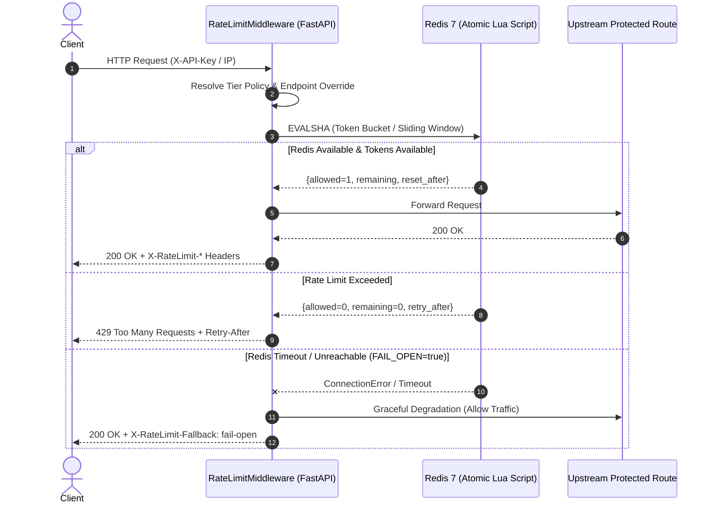

# Sentinel-Gateway


**Sentinel-Gateway** is a cloud-native, high-performance **Distributed Rate Limiter & API Guard** microservice built with **Python 3.12, FastAPI, and Redis**. Designed as a distributed traffic-shaping companion to [Sentinel-WAF-Proxy](https://github.com/mykhaylobogomaz/Sentinel-WAF-Proxy), it protects upstream APIs from abuse, traffic spikes, and resource exhaustion with sub-millisecond overhead.

---

## Architecture & Request Lifecycle

Every incoming API request passes through an asynchronous middleware layer that resolves client identity (`X-API-Key` or client IP), selects the tier policy, and executes an **atomic Lua script** inside Redis before forwarding traffic upstream.



---

## Key Engineering Decisions & Trade-offs

1. **Atomic Redis Lua Scripts vs. `GET`/`SET` Pipelines:**
   Standard read-modify-write sequences introduce race conditions when multiple gateway replicas handle concurrent bursts. Executing the entire check-and-decrement logic inside Redis Lua scripts guarantees **single-threaded atomic execution** with a single network round-trip.
2. **Dual Rate-Limiting Algorithms:**
   - **Token Bucket (Default):** Smoothly enforces average throughput while permitting controlled short-term bursts (`capacity` vs. `refill_rate`).
   - **Weighted Sliding Window Counter:** Approximates a true rolling window in $O(1)$ space and $O(1)$ time by weighting the previous fixed window against the current window—eliminating the boundary-spike flaw of fixed windows without storing per-request timestamps.
3. **Fail-Open Resilience (Graceful Degradation):**
   In distributed architectures, an auxiliary rate-limiting store must not become a single point of failure. When `FAIL_OPEN=true`, Redis network timeouts trigger structured warnings and allow legitimate traffic through rather than causing an API outage.
4. **Standardized HTTP Rate-Limit Telemetry:**
   Every response includes `X-RateLimit-Limit`, `X-RateLimit-Remaining`, `X-RateLimit-Reset`, and `X-RateLimit-Policy`, plus `Retry-After` on `HTTP 429 Too Many Requests`.

---

## Quickstart (One Command)

### 1. Start the Stack with Docker Compose
```bash
docker-compose up --build
```
Once running, interactive Swagger UI documentation is available at:
- **Swagger UI:** `http://localhost:8000/docs`
- **Health Check:** `http://localhost:8000/health`
- **Telemetry Metrics:** `http://localhost:8000/metrics`

### 2. Test Rate Limiting via `curl`

**Standard protected endpoint (`free` tier — burst capacity of 10):**
```bash
curl -i http://localhost:8000/api/v1/resource
```

**Trigger `HTTP 429 Too Many Requests` on the compute-heavy endpoint (`free` tier — burst capacity of 3):**
```bash
for i in {1..5}; do
  curl -s -o /dev/null -w "Request $i -> HTTP %{http_code}\n" \
    -X POST http://localhost:8000/api/v1/analyze \
    -H "Content-Type: application/json" \
    -d '{"payload": "GET /admin HTTP/1.1"}'
done
```

**Elevate tier using a Pro API Key (burst capacity of 60):**
```bash
curl -i http://localhost:8000/api/v1/resource \
  -H "X-API-Key: sg_pro_demo_key"
```

**Switch algorithm dynamically to Sliding Window:**
```bash
curl -i http://localhost:8000/api/v1/resource \
  -H "X-RateLimit-Algorithm: sliding_window"
```

---

## Running Tests Locally

```bash
python -m venv .venv
source .venv/bin/activate  # On Windows: .venv\Scripts\activate
pip install -r requirements.txt

# Start Redis (if not running locally)
docker run -d --name sentinel-test-redis -p 6379:6379 redis:7-alpine

# Run linter and async integration tests
ruff check .
pytest -v
```

---

## Project Structure

```text
Sentinel-Gateway/
├── .github/workflows/ci.yml   # GitHub Actions CI (Ruff + Pytest + Redis service)
├── app/
│   ├── api/routes.py          # /health, /metrics, and protected demo endpoints
│   ├── core/
│   │   ├── config.py          # Pydantic settings & tiered rate-limit policies
│   │   ├── limiter.py         # Async limiter engine, metrics & fail-open logic
│   │   └── lua_scripts.py     # Atomic Token Bucket & Sliding Window Lua scripts
│   ├── middleware/
│   │   └── rate_limit.py      # FastAPI rate-limiting & header injection middleware
│   └── main.py                # Application factory & lifespan management
├── tests/
│   ├── conftest.py            # Async Redis & HTTPX test fixtures
│   ├── test_algorithms.py     # Burst, rollover, concurrency & fail-open tests
│   └── test_middleware.py     # End-to-end HTTP status & header verification
├── Dockerfile                 # Multi-stage non-root production container
├── docker-compose.yml         # Gateway + Redis stack with healthchecks
├── pyproject.toml             # Ruff & Pytest configuration
└── requirements.txt           # Pinned production & test dependencies
```
